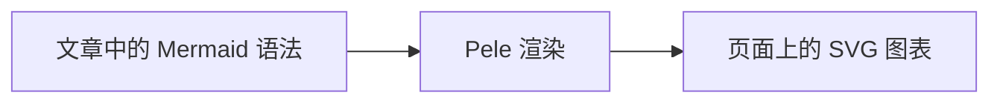

暑假的时候突然兴起想重制下博客,从想法完善到开始制作再到逐步优化,中间断断续续,到现在差不断算优化到了一个我比较满意的节点,于是用这篇博客稍微记录一下

## 想法的起点

其实这个想法并不是以"重制博客"开始的,也就是说重制博客并非我的目的,真正的始因其实是我当时在思考: 是否可以将应用的部分交互和表现 **轻游戏化** (主要体现为交互反馈和成就可视化)

诚然,这种轻游戏化除了多给你的电脑带来一些占用外和大部分应用所追求的"效率"是完全没有挂钩的了.但就像我们也通常乐忠于给自己的网站多加一点漂亮的动效一样,轻游戏化带来的也是这种"表现冲击力"和"情绪价值"

所以我把想法聚焦于哪些轻于"效率"但重于"情绪价值"的场景下.于是我就非常自然的想到 **博客** 这个场景并将其和 **类沙盒** 的搭建小镇这种表现形式联想起来.可以说,这就是在开始的一瞬间就已经决定好的方向.

于是我就开始准备改造我的博客了,并且从一开始我就打算要将其抽出来作为一个博客框架,可能是因为当时我个人并没有发现类似的想法出现,对这个idea比较自信吧,并且觉得确实挺好玩的

## 初版小镇制作

想法出现后就开始围绕着"小镇"这个主题开始构想表现形式,UX,UI等等设计.并确定技术选型

当时就确定下来以 Astro 作为博客底层框架,主要是考虑到 Astro 的网页性能非常强,能让读者获得相对更好的浏览体验

对于这个 idea 来说,最重要的还是"小镇"这部分.一开始是因为看到 *Ithya: Magic Studies* 这个游戏的画风很喜欢于是想模仿这种比较简约的彩绘风.然后又想做成 2.5D 的效果,于是决定下来使用 Three.js 进行建模

由于我没有太好办法获得满意的美术资产,也受限于之前 AI 的建模能力,这套最开始确定下来的视觉风格未能达到一个好的效果.但此时肯定也不能因为这个原因顾此失彼了,于是还是就在这套并不让人满意的建模下完善了整套生成和交互逻辑

最关键的肯定是 **根据文章自动生成建筑,建筑绑定为文章入口** 这个核心逻辑,于是就围绕这个功能进行 debug 和优化.并考虑到博客也得有博客的样子,于是除了小镇以外还是留出来了一个普通的文章列表入口.在反反复复的调整后,初版的博客就顶着这个不太好看的面貌算是基本完工了

## 风格翻版

而如你所见,现在我们小镇的风格已经不是前面我打算做到的"彩绘风"了,而是乐高风.发生这层转变的原因还是对之前那套视觉效果的不满意,契机则是 GPT6 Astra 发布后,听说此模型加强了建模能力,于是就想用 Astra 重制下我小镇的建模来尝尝咸淡

但可能是因为模型刚出时降智率较大,最开始尝试了几版效果都不尽人意,于是我开始反思就当时我能使用的资源强度可能还是很难达到想表达的那种风格,于是我灵光乍现的想到直接换一个风格:乐高风,一个应该能兼顾 AI 产出可行性和视觉效果的风格

而由于和先前版本比起来完全是推翻重做,于是我索性直接从使用 Three.js 换成了 Babylon.js.而初次生成时就获得了和当前版本相近的视觉效果,我认为几乎符合了我的预期,于是就把"乐高风"给确定下来了.后面一段时间内就主要是对小镇内部的一些细节再进行调整

## 界面重制

### UI

主体小镇风格重制完后一直计划着更新一下 UI,因为之前的UI和这个新的"乐高小镇" 有些格格不入了.最开始还是希望打造同样乐高风的 UI,但后面一是因为我没能制作出完全让我满意的"乐高风 UI",二是后面认为简约风的UI也足够合适,于是有了现在蓝白配色的 UI

UI 主题色重制为白色后,我诞生了想将小镇重制为同样主色调可以是白色的冰雪版本的想法,但后面认为做成四季版本通用性更强,性价比更高,于是做了四季切换的功能.而其他地图小镇的想法可能会作为后面的可更新项,带来更丰富的可玩性

### UX

比起 UI 来说,UX 的调整才是真正关键的.我还是认为,就算这个 idea 的核心部分是"小镇",但既然它要和"博客"这个载体融合起来,那它就得有作为一个博客该有的交互效率,所以即便我前面的许多工作都是为了提高小镇的沉浸感和存在感,但依旧不想因为"小镇"这个主体而顾此失彼

#### 导航

最主要的改动还是顶部导航栏和侧边栏的入口规划.之前的顶部栏只放了搜索框和夜间四季的更换按钮,而"小镇"和"档案"的切换被集成到了侧边栏的上部,这就导致了侧边栏的职责臃肿且混乱.

因为我想强调小镇部分的存在感,于是侧边栏就成了我所期待的担任绝大部分导航工作的区域,所以我决定把侧边栏的入口重构并且让它的交互完全与主页面独立.这样改动后侧边栏就有点像常驻在小镇旁的一个常规博客区域了,而顶部导航栏终于担任起了"导航"的作用,且职责非常清晰,我当前对这套交互逻辑的效率还是非常满意的

#### 提示

后来我意识到可能不少第一次进入本博客的朋友还是无法第一直觉把建筑和文章关联起来,只觉得小镇部分是一个装饰,为了解决这个问题,并且把小镇中的建筑拔高到一个更值得选择的入口,于是加入了初次使用的提示和新文章提示.虽然只是个小细节,但我认为这是在用户面前让小镇和博客之间紧密关联起来的关键

在导航的交互和提示足够有效后,我认为已经有条件进一步提升小镇的地位了,那就是移除本来被我放到主页面小镇下方的"最近文章列表",最开始觉得大部分博客网站都有这个部分,且在之前我博客交互效率还不够高的时候这个列表的确是最为快捷方便的,所以就留下了.但在其他UX的增强后我认为移除这部分会是更好的选择,在几乎不削弱浏览体验的前提下加强博客的独特性

## 移动端优化

其实移动端的优化并不是在页面重制结束后再进行的,而是一直穿插在前面的过程中,主要的优化分为两部分

### 加载速度

其实一开始我根本没有注意到移动端的性能问题,因为在制作时几乎没有关注移动端的表现(完全是个人疏漏).直到我将网站分享给一个朋友,他用手机打开时发现小镇的渲染时间久得离谱,能看到下方的最近文章列表但上方的小镇只有白花花一片空白

我的解决方法也很简单:
1. 先尽可能做一次对整体的性能优化
2. 对移动端采取降级措施针对优化

整体优化的目标主要是启动速度,通过 **延迟加载** 的方案,让首帧尽快出现,完成后再进行异步初始化,让 Glow、Highlight、FXAA 等后处理效果延迟加载

针对优化直接给移动端设定独立的轻量渲染质量档位,降低分辨率、阴影质量和帧率,并减少地形实例和装饰物数量

这次优化后只牺牲了移动端的部分视觉精细度,但换来了加载速度的质的飞跃,能做到开屏即小镇的秒开,几乎完全不会影响到体验感,我认为在这个场景下加载速度的确更为重要

### 交互设计

在解决完性能问题后,就开始关注起移动端的体验了,每次改动都会考虑到移动端,其中最主要的就是交互设计,毕竟移动端和桌面端的交互差异是相当大的,必须要单独调整

由于移动端的侧边栏肯定是默认折叠的,所以肯定无法让侧边栏完全承担起列表展示的作用,于是之前提到在桌面端移除的最近文章列表为了保证阅读效率在移动端中还是保留了下来

侧边栏和顶部导航栏的入口也和桌面端做出了区分,主要就是为了在移动端这种窄页面的场景下带来更符合直觉的信息层级规划

文章内部的目录也做了单独调整,最开始 AI 做出来的目录居然固定在了文章顶端,那这样目录的导航作用就变得残缺了.~~虽然最开始的确是我自己没有提到移动端的设计,但还是不得不说 AI 的自发设计能力有点太不讲究了.~~于是我现在把目录折叠到了悬浮球内,在不影响阅读的同时起到全局目录的作用

## 文章功能加强

前面的大部分工作都是围绕着博客的"表"进行的,但博客的"里"一直都还没有去检查去优化,一直到最近我才想起来博客框架若想足够好用,还是要在文章功能本身上下功夫,于是我当下的改动清单如下:

- [x] 小镇建模
- [x] UI
- [x] UX
- [ ] 文章功能
### markdown渲染

说来好笑,最初的版本连基础的 markdown 语法都无法全部正常渲染,如 ***删除线*** 和 ***任务列表*** 都无法渲染~~(肯定不是因为我前面一直没有仔细检查文章界面)~~,而后面发现后也才算成为了整个文章功能加强开始的契机

这部分也没什么特别的,至少现在能正常渲染出所有 markdown 语法,能作为一个正常的 markdown 阅读器了

但仅此肯定当不了足够好用的博客展示器,于是有了下面一系列的==加强功能==

### 数学公式和图表

这两个其实也算是必备的功能了,但在我排查到之前原先的版本确实不支持 LateX 和 Mermaid 的渲染,现在已经实现

用 MathJax 生成 SVG 渲染数学公式,用 Pele 保留 Mermaid 语法生成 SVG 渲染图表.可以说都选择了性能非常出众的方案,为了能获得更佳的阅读体验

比如下面这张图,写在文章里的仍然是 Mermaid 语法,展示出来的则是 Pele 生成的 SVG:



### 提示框

我发现写博客时经常遇到一个需求:后注^

> [!grey] ^
> 作者用注释的形式对之前博文的补充或修订

当时就想做一个特殊的后注渲染,但我意识到这种注释框的渲染不如直接做成更万用更自由的提示框

> [!blue]+ 备注
> 提示框的语法和样式借鉴了 Obsidian,并做了一些简化
> > [!purple]- 详细语法
> > ```markdown
> > > [!blue] 阅读提示
> > > 支持 **粗体**、==高亮==、链接、列表、代码与公式。
> > > 每一行继续以 > 开始。
> > > > [!purple]- 嵌套且默认收起
> > > > 这里是内层内容。
> > > [!red]+ 默认展开，可点击标题折叠
> > > 内容。
> > > [!green]
> > > 不需要标题时省略标题。
> > > [!]- 不指定颜色，默认蓝色
> > > 默认收起的内容。
> > ```

### 内容引用和嵌入

既然都想到 Obsidian 了,那自然也就会想到 Obsidian 当中最具特色的双向链接.但我完全没有打算让博客成为所谓的笔记集,那是在 Obsidian 中该干的事情,所以我并没有做反向链接和关系网,只采纳了我认为其中在博客场景下最有意义的一部分功能: 文章章节/块引用.

内容引用这个功能存在与博客当中的确足够合适且有用,作者能在合适的地方指向相关文章其中的相关部分供读者阅读,比如指向前置背景,前置概念或者手动推荐阅读等等

而又不至于像常规链接一样直接指向一整篇文章,即使这篇文章大部分内容都不是这里需要联系的,但读者依旧需要从头开始看,所以做了指向更明确的内容引用,这能大幅提升阅读体验,帮助读者快速定位关键部分.比如我在这里指向我另一篇文章中对 Obsidian 的介绍:[[obsidian-ai-agent-guide#什么是Obsidian]]

既然有了引用,那嵌入肯定也不能落下,它能以可折叠容器的形式直接嵌入 PDF、视频等文件,或者直接嵌入一篇已有文章,也可以像引用一样选取特定章节/块,这在为读者附上一些直接希望他们阅读的材料时会非常有用,比如我在这里嵌入一段我另一篇文章中对 Obsidian 的双向链接的简单介绍:![[obsidian-ai-agent-guide#^c47035|双向链接]]

### 文章创建命令

每次写文章前都要从已有文章中复制好已有的 Frontmatter 再进行更改的确使我厌烦,于是就想到内置一个创建带有基础 Frontmatter 的 Markdown 文件的脚本帮助我快速开始写文章

通过执行 `pnpm new "Flie Name"` 就能快速创建一个带有常用属性头(不自动添加 Series 相关属性)并自动预设 townID 和 date 的 md 文件,自己仅需填入其余对应信息.虽然是个很小的功能但的确很丝滑且实用

## 结语

更新中比较重要的部分应该都写在这里了,于是变成为了现在你在浏览的这个博客网站,我个人现在还是比较满意的: 较好的视觉体验、不错的趣味性、加强的成就感、较高的交互效率、优秀的网页性能、完善的功能、良好的写作体验.虽说是自夸,但我的确认为这是一个好用且值得去用的博客框架

而在此之后其实也有一系列更新计划,从新版博客落地到现在写这篇文章时也又做了不少修修补补,总之因为我自己会长期使用,我也会把这套框架长期优化和更新的,并可能会单独往框架里加入更多可自定义内容

我也顺手用 Giscus 实现了评论功能,也欢迎你在这篇文章下留下评论,提出一些宝贵的建议

若你也想使用这套框架搭建你的博客,或仅仅只是想了解下其他详情,都欢迎光顾[Blog-Town](https://github.com/BURIBURI-ZAEMON1/Blog-Town) ,里面有更详细的简介和使用手册,开箱即用.如果能留下一个🌟我会非常感激